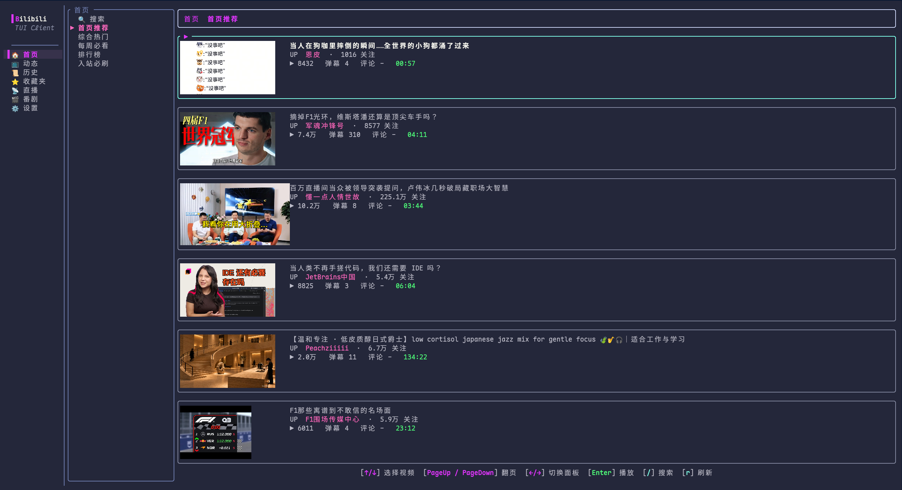
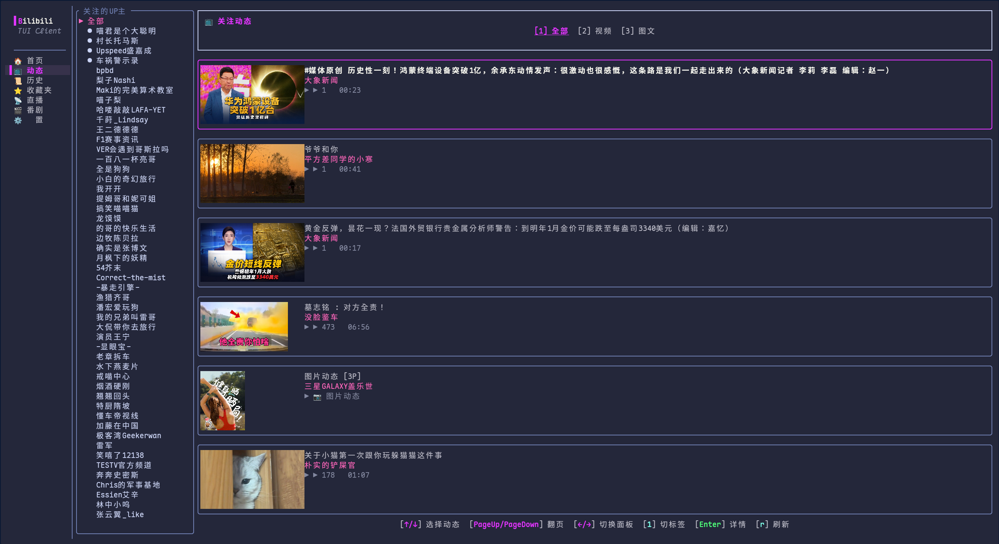
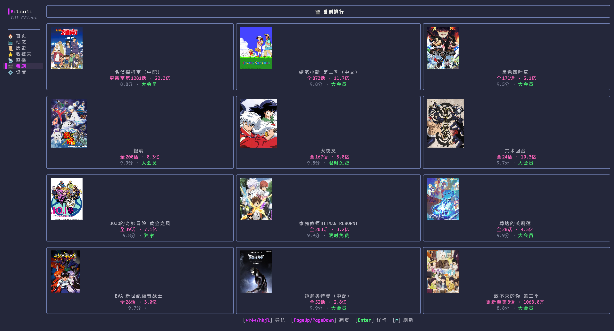
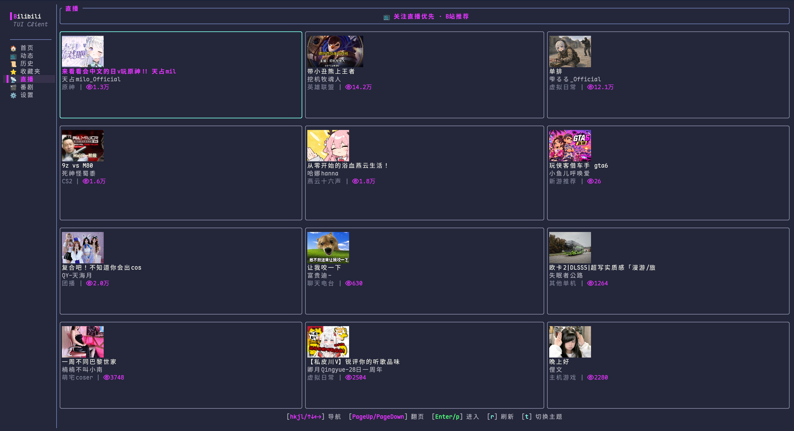
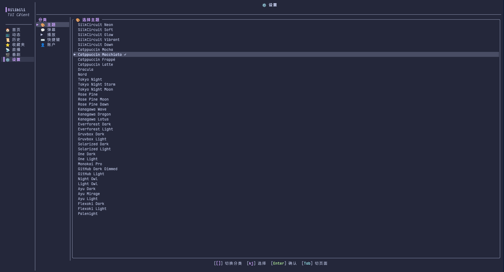
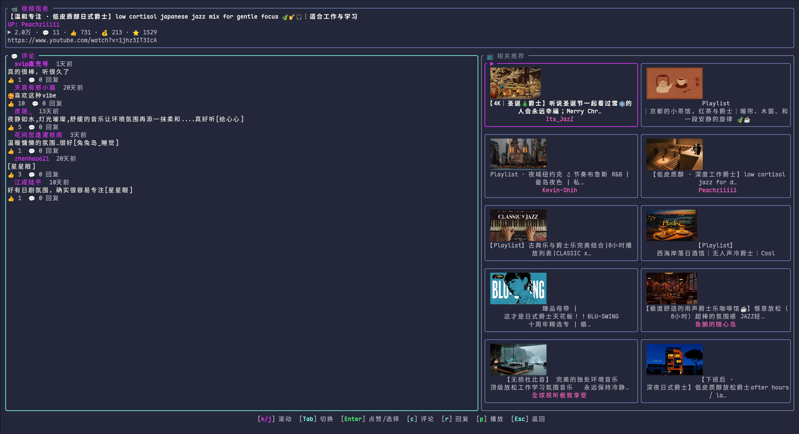

<div align="center">

# bilibili-tui

**把 B 站装进终端。**

推荐、动态、直播、番剧、收藏夹、评论、弹幕与 MPV 播放，一条终端链路完成。

[](https://github.com/MareDevi/bilibili-tui/releases) [](https://www.rust-lang.org/) [](LICENSE) []()

[界面一览](#界面一览) · [功能特性](#功能特性) · [安装](#安装) · [使用](#使用) · [配置文件](#配置文件) · [常见问题](#常见问题) · [技术架构](#技术架构)

</div>

---

## 界面一览

<p align="center">
  
</p>

<p align="center">
  <sub>首页推荐 · 五路内容源 · Catppuccin Macchiato</sub>
</p>

| 关注动态 | 番剧排行 |
| :------: | :------: |
|  |  |
| **动态**：全部 / 视频 / 图文，按 UP 主筛选 | **番剧**：评分、播放量与会员 / 限免 / 独家标识 |

| 直播 | 设置 |
| :--: | :--: |
|  |  |
| **直播**：关注优先 + B 站推荐，展示分区与人气 | **设置**：39 款主题、弹幕、播放、快捷键与账户 |

<p align="center">
  
</p>

<p align="center">
  <sub>视频详情 · 统计、分 P、评论与相关推荐 · <code>Tab</code> 切换焦点</sub>
</p>

> 截图使用 Catppuccin Macchiato 主题。终端需支持真彩色；封面与二维码在支持 Kitty / Sixel / iTerm2 图形协议的终端中显示为图片，否则自动降级为半块字符。

## 功能特性

### 浏览与发现

- **首页五路内容**：`首页推荐`、`综合热门`、`每周必看`、`排行榜`、`入站必刷`。左侧切换内容源，右侧网格浏览，封面异步加载，不阻塞按键。
- **搜索**：热搜词、关键词视频搜索与分页结果；首页按 `/` 直接聚焦搜索面板。
- **关注动态**：`全部 / 视频 / 图文` 三栏，按 UP 主筛选；支持视频、图文与专栏详情，评论点赞、展开回复和发表评论。
- **历史记录**：视频与直播观看记录；`Space` 多选，`Ctrl+A` 全选、`Ctrl+R` 反选，`d` 批量删除。
- **收藏夹**：稍后再看、自建收藏夹与收藏的收藏夹；封面异步加载，收藏夹列表与视频网格切换。
- **直播**：登录后关注主播优先，未登录展示 B 站推荐；卡片展示分区和人气，进入房间后可发送弹幕。
- **番剧**：番剧排行榜，展示封面、评分、播放量及会员 / 限免 / 独家状态；详情页可浏览剧集并播放。
- **UP 空间**：投稿与收藏夹双栏；支持最新 / 热门排序、整页连播，以及顺序 / 倒序 / 随机播放。

### 播放与详情

- **MPV 播放**：视频和直播交给 MPV，支持画质选择、拖动进度、音量与全屏等原生操作。
- **多 P 视频**：分 P 列表选择后连续播放；视频详情页可自动起播。
- **视频详情**：播放统计、UP 主信息、分 P、相关推荐与评论；评论点赞、展开回复、发表评论，`u` 打开当前 UP 主空间。
- **专栏与图文**：动态中的专栏正文、图片与评论可直接在终端阅读。
- **直播播放**：实时弹幕 WebSocket，断流后自动退避重连；房间详情内可发送弹幕。
- **观看记录**：播放过程上报观看进度，配合历史页回看视频与直播记录。

### 外观与交互

- **39 款内置主题**：SilkCircuit、Catppuccin、Dracula、Nord、Tokyo Night、Rosé Pine、Kanagawa、Everforest、Gruvbox、Solarized、One、Monokai Pro、GitHub、Night Owl、Ayu、Flexoki、Palenight。
- **主题即选即用**：列表页按 `t` 循环切换；设置页可预览并确认，选择结果写入配置。
- **可配置键位**：设置页进入按键捕获模式，按下新键立即保存；也可以直接编辑 `config.json`。
- **鼠标操作**：列表页支持点击选中、双击打开与滚轮浏览。
- **终端图片**：封面、直播封面、专栏图片与登录二维码均使用终端图形协议渲染。

### 稳定性与隐私

- **请求隔离**：网络任务独立运行，过期响应自动丢弃，快速切页不会被旧数据覆盖。
- **页面缓存**：首页与番剧页在进入详情后保留列表和选中位置。
- **凭据本地化**：扫码登录后的 Cookie 仅保存在本机，`credentials.json` 以 `0600` 权限写入；播放器使用的临时 Cookie 文件在退出后删除。
- **CDN 优选**：根据本地探测历史为 CDN 线路排序，播放时使用 B 站 `playurl` 返回的签名地址；探测不携带 Cookie 与签名参数。

## 安装

### 运行依赖

| 依赖 | 用途 |
| --- | --- |
| [`mpv`](https://mpv.io/) | 视频与直播的实际播放器 |
| [`yt-dlp`](https://github.com/yt-dlp/yt-dlp) | 流地址解析回退；建议保持最新版本 |
| 终端 | 建议真彩色；图片显示需要终端支持图形协议 |

```bash
# Arch Linux
sudo pacman -S mpv yt-dlp

# Debian / Ubuntu
sudo apt install mpv yt-dlp

# Fedora
sudo dnf install mpv yt-dlp

# macOS
brew install mpv yt-dlp
```

Windows 用户请从 mpv 与 yt-dlp 官方渠道安装，并确保两者都在 `PATH` 中。

### Arch Linux（AUR）

```bash
# 从源码构建
yay -S bilibili-tui

# 或安装预编译包
yay -S bilibili-tui-bin
```

`paru` 用法相同。AUR 包版本可能落后于 GitHub Release；需要最新功能时请选择预编译产物或源码构建。

### macOS / Linux（Homebrew）

```bash
brew install maredevi/tap/bilibili-tui
```

当前 Tap 提供 Apple Silicon macOS 与 x86_64 Linux 构建。Homebrew 不会自动安装 `mpv` / `yt-dlp`，请按上方依赖表准备。

### 预编译产物

前往 [Releases](https://github.com/MareDevi/bilibili-tui/releases) 下载对应平台压缩包：

- `bilibili-tui-x86_64-unknown-linux-gnu.tar.xz`
- `bilibili-tui-aarch64-apple-darwin.tar.xz`
- `bilibili-tui-x86_64-pc-windows-msvc.zip`

### 从源码构建

需要 Rust stable（2024 edition）。Linux 还需要 C 链接器、`pkg-config` 与 OpenSSL 开发包。

```bash
# Debian / Ubuntu
sudo apt install build-essential pkg-config libssl-dev

# Arch Linux
sudo pacman -S base-devel pkgconf openssl

# macOS
xcode-select --install
```

```bash
git clone https://github.com/MareDevi/bilibili-tui.git
cd bilibili-tui
cargo build --release
./target/release/bilibili-tui
```

也可以安装到 Cargo 的二进制目录：

```bash
cargo install --path .
```

> 项目尚未发布到 crates.io，请使用仓库路径安装，而不是 `cargo install bilibili-tui`。

### mise

仓库提供 `mise.toml`，会安装 Rust 工具链与 `prek`：

```bash
mise install
mise exec cargo run --release
```

### Nix

```bash
nix develop
cargo run --release
```

Flake 的 devShell 包含 Rust、`mpv`、`yt-dlp`、`cargo-dist` 与 `pre-commit`。

## 使用

### 首次启动与登录

```bash
bilibili-tui
```

未登录也可以浏览首页推荐、搜索、直播与番剧。关注动态、历史、收藏夹、我的主页、评论互动与直播弹幕发送需要登录。

登录流程：

1. 进入 `设置` → `👤 账户`。
2. 选择 `去登录`，终端显示登录二维码。
3. 使用哔哩哔哩 App 扫码；二维码过期时按 `r` 刷新，`q` 退出登录页。

### 页面与导航

正常模式侧栏：

```text
🏠 首页    📺 动态    📜 历史    ⭐ 收藏夹    📡 直播    🎬 番剧    ⚙️ 设置
```

极简模式侧栏：

```text
🔍 搜索    📺 动态    📜 历史    ⭐ 收藏夹    👤 我的主页    ⚙️ 设置
```

- `Tab` / `Shift+Tab` 在侧栏页面之间切换。
- `Enter` 打开选中项；`Esc` 返回上一层；`q` 退出程序（详情页中返回列表）。
- 首页按 `/` 聚焦搜索；极简模式启动后直接落在搜索页。
- 在列表或视频详情中按 `u` 打开当前 UP 主空间；极简模式的 `我的主页` 打开自己的空间。
- 详情页的 `Tab` 用于切换评论、分 P、相关推荐等焦点，不用于侧栏跳转。

### 常用快捷键

以下为默认键位，均可在设置页或 `config.json` 中修改。

| 按键 | 动作 |
| --- | --- |
| `↑` `↓` `←` `→` / `k` `j` `h` `l` | 移动选择 / 切换面板 |
| `Tab` / `Shift+Tab` | 侧栏页面切换；详情页内切换焦点 |
| `PageUp` / `PageDown` | 列表整页滚动 |
| `Enter` | 确认、打开详情或播放（随页面而定） |
| `Esc` | 返回 / 取消 |
| `q` | 退出程序；详情页中返回列表 |
| `r` | 刷新；评论焦点下展开 / 收起回复 |
| `/` | 首页聚焦搜索 |
| `t` | 首页、历史、直播、番剧页切换主题 |
| `s` | 首页、直播、番剧页打开设置；UP 空间页为切换播放顺序 |
| `p` | 播放 / 连播（随页面而定） |
| `c` | 发表评论；直播房间内发送弹幕 |
| `u` | 打开当前 UP 主空间 |

### 页面速查

- **首页**：左侧 `j/k` 切换内容源，`←/→` 在源列表与内容网格之间切换；`Enter` 打开视频详情（开启自动播放时直接起播）；`r` 刷新。
- **搜索**：默认处于输入模式，输入关键词后 `Enter` 搜索，`Esc` 取消；结果页用方向键或 `h/j/k/l` 导航，`PageUp/PageDown` 翻页。
- **动态**：`1/2/3` 切换全部 / 视频 / 图文；`←/→` 在 UP 列表与动态流之间切换；`Enter` 打开详情，`u` 打开选中 UP 主空间。
- **历史**：`Space` 选择单条，`Ctrl+A` 全选，`Ctrl+R` 反选，`d` 删除所选，`Enter` 打开详情，`Esc` 取消选择。
- **收藏夹**：`←/→` 在收藏夹列表与视频网格之间切换；`Enter` 打开；`Tab` / `Shift+Tab` 切换侧栏页面。
- **直播**：`Enter` / `p` 进入房间；房间内 `Enter` / `p` 播放，`c` 发送弹幕，`Esc` 返回。
- **番剧**：方向键或 `h/j/k/l` 浏览排行榜；`Enter` 打开详情；详情页 `Enter` / `p` 播放选中剧集。
- **UP 空间**：`1/2` 切换投稿 / 收藏夹；`o` 切换排序（投稿：最新 / 热门，收藏夹：最近收藏 / 最多播放 / 最新发布）；`s` 切换顺序 / 倒序 / 随机；`p` 连播。
- **视频详情**：`Tab` 切换评论、分 P、相关推荐；`Enter` 点赞选中评论、播放分 P 或打开相关视频；`c` 评论；`r` 展开 / 收起回复；`p` 播放；`u` 打开 UP 主空间。
- **动态详情**：方向键滚动，`←/→` 浏览多图，`c` 评论，`n` 加载更多，`Esc` 返回。
- **专栏详情**：方向键滚动，`PageUp` / `PageDown` 翻页，`Esc` 返回。
- **设置**：`[` / `]` 切换分类，`j/k` 选择，`Enter` 确认，`h/l` 调整播放选项，`Tab` 切到下一页面。

### 鼠标操作

列表页支持鼠标点击选中、双击打开和滚轮滚动。不同终端与复用器对鼠标事件、图形协议的支持程度不同；若图片或鼠标行为异常，可换用 Kitty、WezTerm、Ghostty 或 iTerm2 验证。

### 极简模式

`设置` → `▶ 播放` → `极简模式（屏蔽推荐流）`。

开启后：

- 启动进入搜索页，不再默认展示首页推荐流。
- 侧栏隐藏首页、直播与番剧。
- 保留搜索、关注动态、历史、收藏夹和我的主页。

## 播放、弹幕与观看记录

### 播放链路

视频播放由 MPV 子进程完成，应用通过 IPC 观察播放状态。播放地址来自 B 站 `playurl` 接口，经本地媒体代理转发，并按 CDN 历史评分选择线路；代理不可用时回退到 `yt-dlp` 解析。

- 画质支持：最佳、4K、1080P+/60、1080P、720P、480P、360P。
- 自动播放默认开启，可在 `设置` → `▶ 播放` 中关闭。
- 多 P 视频、UP 主投稿和收藏夹支持整页连播。
- 播放开始、进度心跳和结束事件会同步到 B 站观看记录。

### 弹幕

应用内置 Lua OSD 弹幕渲染，视频与直播共用同一套渲染器，不依赖外部 MPV 弹幕插件。

弹幕设置位于 `设置` → `💬 弹幕`：

- 开关、显示区域、透明度；
- 字体缩放、持续时间、描边宽度、行高；
- 海量弹幕模式、字体族；
- 直播房间内按 `c` 输入并发送弹幕（需要登录）。

> 如果全局 MPV 配置中还加载了第三方 B 站弹幕脚本，可能出现重复弹幕，建议与应用内置弹幕二选一。应用不内置 SponsorBlock；需要跳过恰饭片段时，可在 MPV 侧自行配置社区脚本。

### 拖动进度后短暂无声？

B 站使用 DASH 分离的音视频流，MPV 在部分配置下精确 seek 会短暂丢失音频。建议启用精确 seek：

```conf
# ~/.config/mpv/mpv.conf
hr-seek=yes
```

## 主题与设置

设置页包含五个分类：

| 分类 | 内容 |
| --- | --- |
| 🎨 主题 | 39 款内置主题，方向键选择，`Enter` 确认 |
| 💬 弹幕 | 开关、区域、透明度、字号、时长、描边、行高、海量模式、字体 |
| ▶ 播放 | 自动播放、默认画质、极简模式 |
| ⌨️ 快捷键 | 25 个动作的按键捕获与即时保存 |
| 👤 账户 | 登录 / 退出登录 |

主题按系列分组：

| 系列 | 主题 |
| --- | --- |
| SilkCircuit | Neon / Soft / Glow / Vibrant / Dawn |
| Catppuccin | Mocha / Macchiato / Frappe / Latte |
| Dracula | Dracula |
| Nord | Nord |
| Tokyo Night | Night / Storm / Moon |
| Rosé Pine | Rose Pine / Moon / Dawn |
| Kanagawa | Wave / Dragon / Lotus |
| Everforest | Dark / Light |
| Gruvbox | Dark / Light |
| Solarized | Dark / Light |
| One | Dark / Light |
| Monokai Pro | Monokai Pro |
| GitHub | Dark Dimmed / Light |
| Night Owl | Night Owl / Light Owl |
| Ayu | Dark / Mirage / Light |
| Flexoki | Dark / Light |
| Palenight | Palenight |

主题选择会立即保存。若手动写入的主题 ID 不存在，应用会回退到默认主题，并在底部提示前往设置页重新选择。

## 配置文件

### 路径

| 平台 | 目录 |
| --- | --- |
| Linux | `${XDG_CONFIG_HOME:-~/.config}/bilibili-tui/` |
| macOS | `~/Library/Application Support/bilibili-tui/` |
| Windows | `%APPDATA%\bilibili-tui\` |

| 文件 | 作用 |
| --- | --- |
| `config.json` | 主题、键位、弹幕、播放与极简模式设置 |
| `credentials.json` | 扫码登录后的 Cookie，`0600` 权限，登出时删除 |
| `cdn-history.json` | 本地 CDN 探测与评分历史，仅用于线路排序 |

设置页中的修改会立即保存；手动编辑 JSON 后请重启应用。

### `config.json`

```json
{
  "theme": "catppuccin-macchiato",
  "auto_play": true,
  "minimal_mode": false,
  "video_quality": "q720p",
  "keybindings": {
    "quit": "q",
    "confirm": "Enter",
    "back": "Esc",
    "nav_up": "k",
    "nav_down": "j",
    "nav_left": "h",
    "nav_right": "l",
    "nav_next_page": "Tab",
    "nav_prev_page": "BackTab",
    "next_theme": "t"
  },
  "danmaku": {
    "enabled": true,
    "display_area": 0.5,
    "opacity": 1.0,
    "font_scale": 1.0,
    "duration": 7.0,
    "stroke_width": 2.5,
    "line_height": 1.6,
    "massive_mode": false,
    "font_family": "Noto Sans CJK SC"
  }
}
```

`video_quality` 可选值：

```text
best  q4k  q1080p_high  q1080p  q720p  q480p  q360p
```

`keybindings` 与 `danmaku` 可以只写需要覆盖的字段，其余字段使用默认值。主题 ID 使用小写连字符形式，例如 `catppuccin-macchiato`、`tokyo-night-storm`、`rose-pine-moon`。

<details>
<summary>全部 25 个键位字段与默认值</summary>

| 字段 | 默认 | 说明 |
| --- | --- | --- |
| `quit` | `q` | 退出 |
| `confirm` | `Enter` | 确认 |
| `back` | `Esc` | 返回 |
| `refresh` | `r` | 刷新 |
| `nav_up` | `k` | 向上 |
| `nav_down` | `j` | 向下 |
| `nav_left` | `h` | 向左 |
| `nav_right` | `l` | 向右 |
| `nav_next_page` | `Tab` | 下一页面 |
| `nav_prev_page` | `BackTab` | 上一页面 |
| `page_down` | `PageDown` | 内容下翻页 |
| `page_up` | `PageUp` | 内容上翻页 |
| `section_prev` | `[` | 上一分区 |
| `section_next` | `]` | 下一分区 |
| `tab_1` | `1` | 标签 1 |
| `tab_2` | `2` | 标签 2 |
| `tab_3` | `3` | 标签 3 |
| `next_theme` | `t` | 切换主题 |
| `play` | `p` | 播放 |
| `open_settings` | `s` | 打开设置 |
| `search_focus` | `/` | 聚焦搜索 |
| `comment` | `c` | 评论 |
| `toggle_replies` | `r` | 展开 / 收起回复 |
| `up_prev` | `[` | 上一 UP |
| `up_next` | `]` | 下一 UP |

</details>

按键值支持单个字符，或 `Enter`、`Esc`、`Tab`、`BackTab`、`PageUp`、`PageDown`、方向键、`Space`、`F1`–`F12` 等命名键。

### 凭据与隐私

- 登录使用 B 站二维码，应用不会索取账号密码。
- `credentials.json` 由扫码结果自动写入，使用临时文件替换并设置 `0600` 权限；退出登录会删除该文件。
- 播放时导出的临时 Cookie 文件同样为 `0600`，播放器退出后删除。
- CDN 探测只针对裸主机做连通性与延迟测试，不携带 Cookie 或签名参数；结果仅用于本地线路排序。实际播放始终使用 B 站接口返回的已签名地址，应用不会篡改签名 URL。

## 常见问题

**封面或二维码不显示 / 显示为字符块**

终端未提供可用的图形协议。请使用支持 Kitty、Sixel 或 iTerm2 图形协议的终端（如 Kitty、WezTerm、Ghostty、iTerm2），并确认终端为真彩色。tmux 等复用器可能会吞掉图形协议，可先在裸终端中验证。

**视频无法播放 / 没有声音**

依次确认：

```bash
mpv --version
yt-dlp --version
```

确保两者都在 `PATH` 中，并更新 `yt-dlp`。部分视频受大会员、地区或版权限制，应用无法绕过平台限制。若拖动后短暂无声，见上方 `hr-seek=yes`。

**登录二维码过期**

在登录页按 `r` 刷新二维码；若持续失败，检查系统时间、DNS 与网络代理设置。

**主题没有生效**

手动写入的主题 ID 可能不存在。进入 `设置` → `🎨 主题` 重新选择；应用会回退到默认主题并给出提示。

**历史 / 收藏夹 / 动态为空**

这些页面需要登录。进入 `设置` → `👤 账户` 完成扫码登录；若刚登录，按 `r` 刷新当前页面。

**Windows 上如何运行？**

Releases 提供 Windows x86_64 构建。运行前请安装 `mpv` 与 `yt-dlp` 并加入 `PATH`，使用支持 ANSI 与鼠标事件的终端。

**如何彻底退出登录？**

`设置` → `👤 账户` → `退出登录`。这会删除本地 `credentials.json` 并清除 API 客户端中的 Cookie。

## 技术架构

应用采用分层 + 动作驱动的结构：页面只负责渲染和输入，通过 `AppAction` 向 `App` 表达意图；网络、播放和持久化由独立模块处理。

```text
src/
├── main.rs             # 终端初始化与事件循环启动
├── app/                # App 状态机、运行时、动作分发、网络事件
├── application/        # AppAction 定义与后台网络 worker
├── domain/             # 播放队列等领域模型
├── api/                # B 站 API、WBI 签名、直播 WebSocket、CDN 评分
├── player/             # MPV 编排、媒体代理、弹幕 Lua
├── ui/                 # 页面组件、侧栏、主题、视频卡片
├── infrastructure/     # B 站、媒体与配置持久化适配
├── presentation/       # TUI 对外导出
└── storage/            # config.json、credentials.json 与键位
```

```text
键盘 / 鼠标
    │
    ▼
Page::handle_input  ──►  AppAction
                              │
                              ▼
                       App::handle_action
                         ├── API 请求 ──► 网络 worker ──► 页面更新
                         ├── 播放 ─────► mpv + 本地媒体代理
                         └── 设置 ─────► config.json
```

### 技术栈

| 领域 | 选型 |
| --- | --- |
| TUI | Ratatui + Crossterm |
| 终端图片 | ratatui-image |
| 异步运行时 | Tokio |
| HTTP | reqwest |
| 直播 WebSocket | tokio-tungstenite |
| 数据解析 | serde / serde_json / quick-xml |
| 压缩 | flate2 / brotli |
| 主题 | Opaline |
| 播放 | mpv / yt-dlp |

### 关键实现

- **API 客户端**：统一 User-Agent 与 Referer，Cookie 与 WBI 密钥放在 `RwLock` 中；WBI 接口自动签名，遇到 `-352` 刷新密钥后重试。
- **请求隔离**：网络 worker 通过 mpsc 接收命令并回传事件，`RequestTracker` 按请求 ID 丢弃过期响应。
- **页面组件**：所有页面实现 `Component`，输入处理返回 `AppAction`，避免页面直接修改全局状态。
- **播放器**：异步启动 MPV，使用 IPC 观察播放状态；视频通过本地媒体代理转发音视频流，直播通过 WebSocket 接收弹幕并支持断流重连。
- **直播协议**：握手后维持心跳，数据包支持 zlib / brotli 解压，解析后的弹幕进入共享的 LiveDanmakuHub。
- **持久化**：配置与凭据通过临时文件原子替换写入；凭据文件权限为 `0600`。

## 开发

```bash
cargo fmt
cargo check
cargo clippy --all-targets --all-features -- -D warnings
cargo test
cargo run
```

运行单个测试：

```bash
cargo test api::wbi::tests::test_encode_wbi
```

提交前建议安装并运行 pre-commit：

```bash
pre-commit install
pre-commit run --all-files
```

项目使用 `mise` 管理工具链与发版任务：

```bash
mise install
mise run release 1.1.0
```

发版任务会检查主分支与工作区、更新 `Cargo.toml`、用 `git-cliff` 生成 `CHANGELOG.md`、提交并推送 tag；后续构建与 Release 由 GitHub Actions 完成。

## 贡献

欢迎提交 Issue 与 Pull Request。

- Bug 报告请附上操作系统、终端、`mpv` / `yt-dlp` 版本、复现步骤与相关日志；请勿粘贴 Cookie 或 `credentials.json` 内容。
- 提交代码前请运行格式化、Clippy 与测试，保持 warning-free。
- 提交信息遵循 Conventional Commits，例如 `fix(player): handle live stream reload`。
- 新增页面或交互时，优先复用 `AppAction`、`Keybindings` 与现有组件模式，避免引入第二套约定。

## 免责声明

本项目是非官方第三方客户端，与哔哩哔哩官方无隶属关系。接口来自 B 站 Web 端公开能力，可能随平台调整而失效。请遵守哔哩哔哩用户协议与相关法律法规，仅将本项目用于个人学习与正常内容浏览。应用不收集账号密码，扫码登录后的凭据仅保存在本机。

## License

[MIT](LICENSE) © MareDevi

## 致谢

感谢这些开源项目与服务：

- [Ratatui](https://github.com/ratatui-org/ratatui) — Rust TUI 框架
- [Crossterm](https://github.com/crossterm-rs/crossterm) — 终端事件与渲染
- [Tokio](https://tokio.rs/) — 异步运行时
- [Reqwest](https://github.com/seanmonstar/reqwest) — HTTP 客户端
- [Opaline](https://github.com/hyperb1iss/opaline) — 主题引擎与配色
- [ratatui-image](https://github.com/ratatui-org/ratatui-image) — 终端图片渲染
- [MPV](https://mpv.io/) — 媒体播放器
- [yt-dlp](https://github.com/yt-dlp/yt-dlp) — 流地址解析
- [bilibili-API-collect](https://github.com/SocialSisterYi/bilibili-API-collect) — B 站 API 资料
- 以及所有提交 Issue、反馈问题与贡献代码的开发者

---

<div align="center">

<sub>Made with ❤️ by MareDevi · 如果它让你的终端更好玩，欢迎 Star ⭐</sub>

</div>
